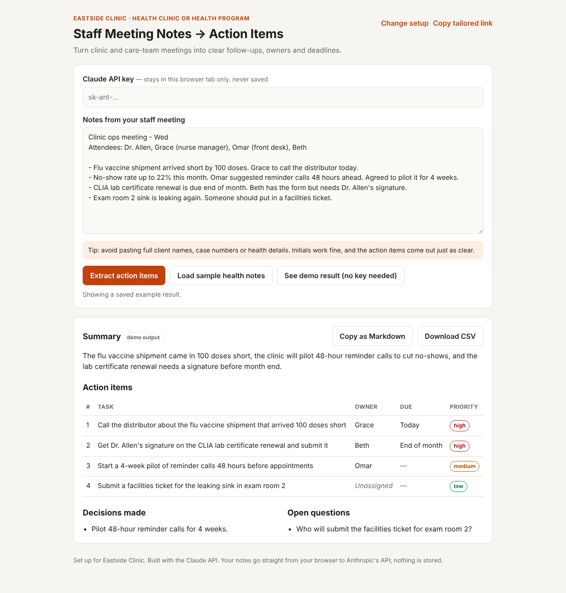

# Meeting Notes → Action Items

A small web tool that turns messy meeting notes into a clean list of **who is doing what, by when**, plus the decisions made and the questions still open. It uses Claude through the Anthropic API.

## Why I built this

I'm a project manager. After most meetings, the hardest part isn't the meeting itself. It's making sure every task has an owner and a deadline, and that nothing said in passing gets lost. Small teams and nonprofits often don't have a dedicated coordinator to do this, so I built a tool that does the first pass in seconds.

## What it does

- **Tailors itself to your organization.** A 30-second setup survey asks for your organization's name and type (food bank, housing, health clinic, youth program, legal aid, workforce, or general), the kind of meetings you run, and what to watch most closely. The page title, wording, sample notes and Claude's priorities all adjust to fit.
- Writes a 2–3 sentence summary of the meeting
- Pulls out every action item with its **owner**, **due date** and **priority**
- Flags tasks that nobody claimed as **Unassigned** instead of guessing an owner
- Lists decisions the group agreed on and the questions still open
- Exports results as **Markdown** (for email or Slack) or **CSV** (for Excel or Google Sheets)

## Try it

**Live demo: [mykel23.github.io/meeting-action-items](https://mykel23.github.io/meeting-action-items/)**

1. Open the live demo, or download `index.html` and open it in any browser. No install needed.
2. Click **See demo result** to view a sample output without an API key.
3. To run it on your own notes, paste a Claude API key (get one at [console.anthropic.com](https://console.anthropic.com)), paste your notes, and click **Extract action items**.

Your key stays in the browser tab and is never saved. Notes are sent directly to Anthropic's API and nowhere else.

## How it works

- A single HTML file with plain JavaScript, no frameworks or build step
- Calls the Claude Messages API with a system prompt that asks for structured JSON
- The prompt includes rules that keep results trustworthy: never invent an owner, keep due dates as written, and treat safety or blocking issues as high priority
- The JSON is rendered into a table and lists, then can be exported

## How the tailoring works

- Each organization type has its own guidance that goes into Claude's instructions. For example, a food bank's fridge temperature problem is flagged high priority, and a legal aid clinic's filing deadline is never dropped.
- The areas a team checks in setup (deadlines, safety, client follow-ups, staffing, budget) tell Claude what it must not miss.
- The setup is remembered in that browser. **Copy tailored link** creates a link (for example `?type=legal&org=Houston+Legal+Aid`) that a whole team can open to skip setup.
- For organizations that handle sensitive client information, the page reminds staff to use initials instead of full names or health details.

## Design choices

- **No guessing owners.** A wrong owner is worse than a blank one, because the task looks handled when it isn't. Unclaimed tasks also appear under open questions.
- **Bring your own key.** No server or account is needed, so anyone can run it for a few cents per meeting.
- **Demo mode.** Reviewers can see the output without an API key.

## Ideas for next steps

- Send action items straight to a task tool (Asana, Trello, Google Sheets)
- Email each owner their own tasks
- Compare against the last meeting to track which items are overdue
